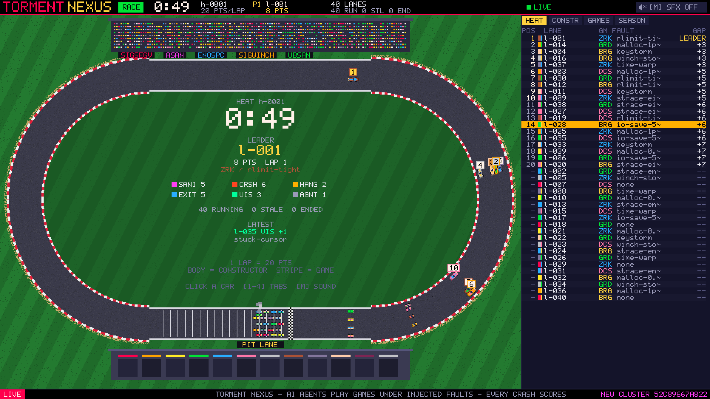

# nexus

The Torment Nexus is a parallel software torment rig.

- **Lanes:** Minimal sandboxes, each running one terminal game.
- **Agent:** a [pi](https://github.com/earendil-works/pi) agent plays each game, with
  inference from Cloudflare Workers AI via the host broker (24 lanes by default, D-041).
  Profiles for Claude and a local LM Studio model are available opt-in.
- **Faults:** each lane runs under one fault-injection profile.
- **Scoreboard:** counts failures per lane and shows them as a neon anti-grav pixel race in
  the browser.
- **Wall:** a zellij wall on the host shows every lane's live terminal.

- **Decision record (start here):** [docs/DECISIONS.md](docs/DECISIONS.md)
- **Interfaces:** [docs/CONTRACTS.md](docs/CONTRACTS.md)
- **Plan and milestones:** [docs/PLAN.md](docs/PLAN.md)
- **Research doc:** https://claude.ai/code/artifact/b10bce23-195d-4e31-8c3d-0b65f2d6ed4a

## Layout

| Path | What |
| --- | --- |
| `harness/` | `nexus-lane`, the lane launcher. Contains `games.toml`, `faults.toml`, the failure detectors (crash with stack hash, sanitizer, hang, error_exit, visual) and the event posting. |
| `lane/` | pi lane runtime: `game.ts` tools, `models.json`, `agent.sh`/`agent.py` driver with a stall watchdog, the `toolfix.py` tool-call recovery proxy, `ttyview.py`, the mock model and the loadout. |
| `scoreboard/` | Go service: `POST /events`, SQLite, heats and scoring, SSE, and the embedded race UI (`web/`). `tools/fake_lanes.py` runs a demo. |
| `visualizer/` | Native Bevy race visualizer: polls `/api/state` and draws the track, cars and timing tower. |
| `wall/` | `wall-gen` (zellij KDL pages), `wall-pager` (paging, Hot tab, focus) and terminal configs. |
| `scaletest/` | Phase A inference probe and a rate-limited mock. |
| `scripts/` | `slice.sh` (several lanes in one box, run as a Minimal task) and `host-up.sh`/`host-down.sh` (real Minimal sessions from the Mac). |

Game and tool packages live in the sideload repo
[noric-labs/torment-pkgs](https://github.com/noric-labs/torment-pkgs):

- **Games:** frotz + Zork I–III, brogue-ce, dcss, greed, bastet, nsnake, pacman4console.
- **Fault and support libraries:** libfiu, libfaketime, torment-seed, torment-crashtrace.

## Quick start

| Goal | Command |
| --- | --- |
| Race UI demo, no games | `cd scoreboard && go build && ./scoreboard -heat 60s -pit 10s`, then `python3 tools/fake_lanes.py` |
| Native visualizer | `cd visualizer && cargo run -- --url http://localhost:8080` (needs Rust 1.97+) |
| Local slice (several lanes in one box) | `min task run slice`; see `scripts/README.md` for the task definitions and knobs (`SLICE_LIVE=1` sends real inference) |
| Real Minimal sessions from the Mac | `scripts/host-up.sh --dry-run`, then `scripts/host-up.sh` |
